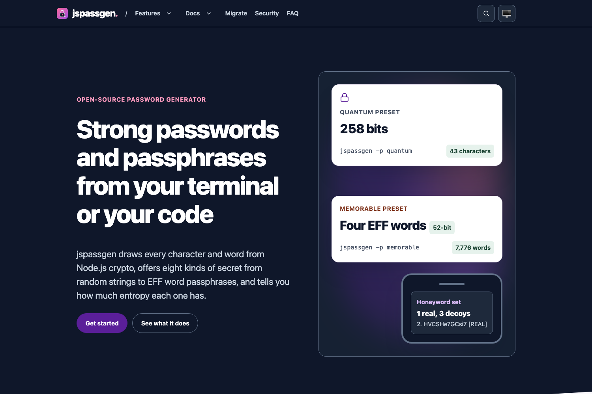

<!-- SPDX-License-Identifier: Apache-2.0 OR MIT -->
<!--
README template. Global rules: see ~/Code/AGENTS.md and ~/Code/REPO-STANDARD.md.
Releases adhere strictly to https://github.com/sebastienrousseau/passmcp/releases/tag/v0.0.5
-->

<p align="center">
  
</p>

<h1 align="center">jspassgen.com</h1>

<p align="center">
  The website for jspassgen, a password and passphrase generator for Node.js, built with Static Site Generator and the Prism theme.
</p>

<p align="center">
  <a href="https://github.com/sebastienrousseau/jspassgen.github.io/actions"></a>
  <a href="https://jspassgen.com/"></a>
  <a href="https://scorecard.dev/viewer/?uri=github.com/sebastienrousseau/jspassgen.github.io"></a>
  <a href="LICENSE-MIT"></a>
</p>

<p align="center">
  
</p>

---

## Contents

**Getting started**

- [Install](#install): what to install to build the site
- [Requirements](#requirements): ssg, Python, Chrome for the screenshot
- [Quick Start](#quick-start): build, check and preview locally

**The jspassgen.com ecosystem**

- [The jspassgen.com ecosystem](#the-jspassgencom-ecosystem): the site, the package it describes, the theme and the generator

**Library reference**

- [Capabilities at a glance](#capabilities-at-a-glance): what the build produces and checks
- [Ecosystem comparison](#ecosystem-comparison): not applicable to a website
- [Benchmarks](#benchmarks): not applicable to a website
- [Features](#features): pages and structure
- [Configuration](#configuration): `ssg.toml` and the content schema
- [Examples](#examples): not applicable to a website

**Operational**

- [When not to use jspassgen.com](#when-not-to-use-jspassgencom): where the reference lives instead
- [Development](#development): make targets and CI
- [Security](#security): CSP, SRI and supply chain
- [Documentation](#documentation): where each part is described
- [Stability guarantees](#stability-guarantees): URLs and build output
- [License](#license)

---

## Install

### As a website project

```bash
git clone https://github.com/sebastienrousseau/jspassgen.github.io.git
cd jspassgen.github.io
```

Install `ssg` 0.0.69 or newer from its
[releases](https://github.com/sebastienrousseau/static-site-generator/releases)
or with `cargo install ssg`.

---

## Requirements

- **ssg** 0.0.69 or newer on `PATH` (CI pins the 0.0.69 release by SHA-256).
- **Python** 3.11 or newer, for the build scripts.
- **Chrome or Chromium**, for the per-page social images in `make build`
  and for `make screenshot`. Set `CHROME` to choose the binary. On macOS
  with the display asleep, full Chrome can hang in headless mode; a
  `chrome-headless-shell` binary does not.

---

## Quick Start

```bash
make build   # build into docs/ and run every check
make serve   # build, then serve on http://127.0.0.1:8000
```

`make build` fails if any check fails, so a passing build is a deployable one.

---

## The jspassgen.com ecosystem

jspassgen.com describes [jspassgen](https://github.com/sebastienrousseau/jspassgen),
a password and passphrase generator for Node.js, and is generated by
[Static Site Generator](https://github.com/sebastienrousseau/static-site-generator).

| Component | Purpose | Use case |
| :--- | :--- | :--- |
| jspassgen.github.io | This repository: content, layouts and build scripts | Changing the website |
| jspassgen | The package the site documents; its source, README, CHANGELOG and SECURITY.md, and the npm registry, are the source of every fact here | Using jspassgen |
| Prism theme | The design, from ssg-themes.github.io (MIT, see `LICENSES/`), recoloured from the jspassgen logo | Restyling the site |
| Static Site Generator | Builds and audits the site | Building locally and in CI |

---

## Capabilities at a glance

| Area | Capability | Status |
| :--- | :--- | :--- |
| Build | ssg compiles `_posts/` with `_layouts/` into `docs/` | Stable |
| Colour | `scripts/contrast.py` holds every text pair to 7:1 and every UI pair to 3:1, in light and both dark blocks, including any rule that sets both `color` and `background` | Enforced in CI |
| Checks | ssg quality gate (10/10 required), heading anchors, cross-page `#fragment` links, SRI hashes, `ssg audit` | Enforced in CI |
| Deploy | GitHub Actions builds and deploys to GitHub Pages; nothing built is committed | Stable |
| Search | ssg's search widget in the header slot | Stable |
| Structured data | WebSite, SoftwareApplication, Person, WebPage | Stable |
| Social images | One 1200x630 Open Graph image per page, rendered at build time by `scripts/og_images.py` | Enforced in CI |

---

## Ecosystem comparison

Not applicable: this repository is a website, not a library.

---

## Benchmarks

Not applicable: this repository is a website.

---

## Features

- Fifteen pages: home, features, getting started, CLI and API reference,
  migration, security, FAQ, about, changelog, contributing, accessibility,
  privacy, terms, colophon and 404. Contact details are on the about page:
  the site has no form.
- A shared header and footer in `_layouts/`, written once for the site.
- Every fact about jspassgen is taken from its repository (source, README,
  CHANGELOG, SECURITY.md, CONTRIBUTING.md) and, where the repository
  disagrees with itself, from the source code and the npm registry; the
  command-line examples were run against the published package.

---

## Configuration

- `ssg.toml`: site name, description, `base_url` and the content, template
  and output directories.
- `_posts/content.schema.toml`: the front-matter fields every page must
  carry; ssg fails the build when one is missing.

---

## Examples

Not applicable: this repository is a website. jspassgen's examples are on the
site's [getting started page](https://jspassgen.com/getting-started/).

---

## When not to use jspassgen.com

The site summarises jspassgen for people deciding whether to use it. The
reference is the jspassgen repository; when it disagrees with this site, it
wins.

---

## Development

```bash
make build       # contrast, ssg build, anchors, post-build checks, og images, ssg audit
make serve       # build and serve locally
make screenshot  # render static/images/screenshot.png from the build
make clean       # remove build output
```

`.github/workflows/quality-gate.yml` runs `make build` on every pull request.
`.github/workflows/pages.yml` runs it on `main` and deploys `docs/` to
GitHub Pages.

---

## Security

Every page carries a strict Content Security Policy: scripts, styles and
images from this origin only, and form submissions to this origin only. Every local script and stylesheet carries a Subresource Integrity
hash, which the build verifies against the file. CI installs ssg from its
release and checks the archive against a pinned SHA-256.

Report vulnerabilities according to [`SECURITY.md`](SECURITY.md).

---

## Documentation

- The website: <https://jspassgen.com/>
- jspassgen: <https://github.com/sebastienrousseau/jspassgen>
- The package: <https://www.npmjs.com/package/@sebastienrousseau/jspassgen>
- Static Site Generator: <https://github.com/sebastienrousseau/static-site-generator>
- Third-party licences: [`LICENSES/`](LICENSES/)

---

## Stability guarantees

The October 2026 site's pages, `/` and `/about/`, are kept; every other page
is new. Its hand-written `llms.txt`, `llms-full.txt`, `openapi.json` and
`/.well-known/agents.json` are gone; the build generates `llms.txt`,
`agents.txt` and `/.well-known/ai-plugin.json`. The sitemap is dated by
the last commit, and CI pins the ssg release it builds with.

---

## License

The site's source is available under [Apache-2.0](LICENSE-APACHE) or
[MIT](LICENSE-MIT), at your option. The Prism theme files in `_layouts/` are
MIT-licensed; see [`LICENSES/`](LICENSES/). jspassgen itself is also
Apache-2.0 OR MIT. The logo in `static/logo.svg` is jspassgen's, from
`.github/assets/logo.svg` in the jspassgen repository.

