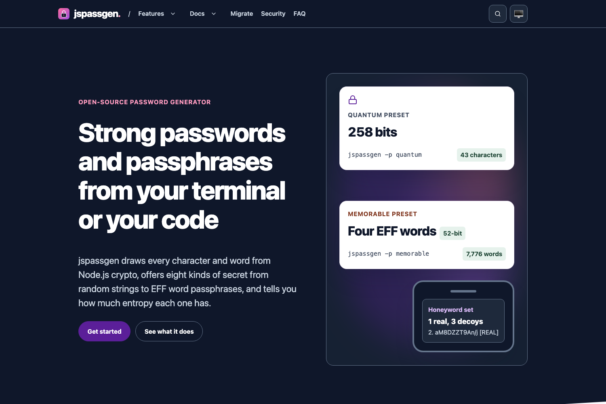

<!-- SPDX-License-Identifier: Apache-2.0 OR MIT -->

<p align="center">
  
</p>

<h1 align="center">jspassgen.com</h1>

<p align="center">
  The source of jspassgen.com, the website for the jspassgen password and passphrase generator, built with Static Site Generator (ssg) and the Prism theme.
</p>

<p align="center">
  <a href="https://github.com/sebastienrousseau/jspassgen.github.io/actions"></a>
  <a href="https://jspassgen.com/"></a>
  <a href="https://jspassgen.com/documentation/"></a>
  <a href="https://scorecard.dev/viewer/?uri=github.com/sebastienrousseau/jspassgen.github.io"></a>
  <a href="LICENSE-APACHE"></a>
  <a href="#requirements"></a>
</p>

<p align="center">
  
</p>

---

## Contents

**Getting started**

- [Install](#install): clone the repository and install ssg
- [Requirements](#requirements): ssg, Python, Chrome for the images
- [Quick Start](#quick-start): build, check and preview locally

**The jspassgen ecosystem**

- [The jspassgen ecosystem](#the-jspassgen-ecosystem): the core library, its tools, native SDKs and this site

**Library reference**

- [Capabilities at a glance](#capabilities-at-a-glance): what the build produces and checks
- [Ecosystem comparison](#ecosystem-comparison): not applicable to a website
- [Benchmarks](#benchmarks): not applicable to a website
- [Features](#features): pages and structure
- [Configuration](#configuration): `ssg.toml` and the content schema
- [Examples](#examples): not applicable to a website

**Operational**

- [When not to use jspassgen.com](#when-not-to-use-jspassgencom): where the reference lives instead
- [Development](#development): make targets and CI
- [Security](#security): CSP, SRI and supply chain
- [Documentation](#documentation): where each part is described
- [Stability guarantees](#stability-guarantees): URLs and build output
- [License](#license)

---

## Install

### As a JavaScript library

This repository is a website, not a library: it exports no code to depend
on.

Clone it to build the site:

```bash
git clone https://github.com/sebastienrousseau/jspassgen.github.io.git
cd jspassgen.github.io
```

Install the latest `ssg` (0.0.76) from its
[releases](https://github.com/sebastienrousseau/static-site-generator/releases)
or with `cargo install ssg --locked`.

---

## Requirements

- The latest ssg, 0.0.76, on `PATH`. CI installs the 0.0.76 release and
  checks the archive against a pinned SHA-256; the pin moves up when a
  newer ssg ships.
- Python 3.11 or newer, for the build scripts (they use `tomllib`).
- Chrome or Chromium, for the per-page social images in `make build` and
  for `make screenshot`. Set `CHROME` to choose the binary. On macOS with
  the display asleep, full Chrome can hang in headless mode; a
  `chrome-headless-shell` binary does not.

---

## Quick Start

```bash
make build   # build into docs/ and run every check
make serve   # build, then serve on http://127.0.0.1:8000
```

`make build` fails if any check fails, so a passing build is a deployable
one.

---

## The jspassgen ecosystem

jspassgen is one core library and the tools, SDKs and site around it.
Every member is listed in
[`docs/ecosystem.json`](https://github.com/sebastienrousseau/jspassgen/blob/main/docs/ecosystem.json)
and, from the suite's first lockstep release, every member ships the same
version ([ADR 0001](https://github.com/sebastienrousseau/jspassgen/blob/main/docs/adr/0001-ecosystem-lockstep.md)).
The JavaScript tools depend on the core and add no generation logic of
their own; each SDK is a native port that is checked against the core's
conformance kit as its generators land.

| Component | Purpose | Use case |
| :--- | :--- | :--- |
| [`jspassgen`](https://github.com/sebastienrousseau/jspassgen) | Password and passphrase core, Node.js library, CLI, web UI and workers; source of the conformance kit | Programs that generate secrets |
| [`jspassgen-cli`](https://github.com/sebastienrousseau/jspassgen-cli) | Command-line generator built on the core | Passwords in a terminal or a script |
| [`jspassgen-mcp`](https://github.com/sebastienrousseau/jspassgen-mcp) | Local stdio MCP server | AI agents that need a generated secret |
| [`jspassgen-lsp`](https://github.com/sebastienrousseau/jspassgen-lsp) | Language server for weak literal secrets | Editors checking configuration and `.env` files |
| [`jspassgen-sdk-python`](https://github.com/sebastienrousseau/jspassgen-sdk-python) | Native port on the `secrets` module | Python programs |
| [`jspassgen-sdk-rust`](https://github.com/sebastienrousseau/jspassgen-sdk-rust) | Native port on the OS CSPRNG | Rust programs |
| [`jspassgen-sdk-java`](https://github.com/sebastienrousseau/jspassgen-sdk-java) | Native port on `SecureRandom` | JVM programs |
| [`jspassgen-sdk-dotnet`](https://github.com/sebastienrousseau/jspassgen-sdk-dotnet) | Native port on `RandomNumberGenerator` | .NET programs |
| [`jspassgen-sdk-cpp`](https://github.com/sebastienrousseau/jspassgen-sdk-cpp) | Native C++17 port on the OS CSPRNG | C++ programs |
| **`jspassgen.com`** | The suite's website, [jspassgen.com](https://jspassgen.com), from this repository | Evaluating the suite |

Every member ships at 0.0.23, the suite's second lockstep release: the
core, CLI, MCP and LSP servers on npm, the Python, Rust, Java and .NET
SDKs on PyPI, crates.io, Maven Central and NuGet, and the C++ SDK and
the site as GitHub releases. The table gives each member's purpose, and
each README's Capabilities at a glance says what works today.

---

## Capabilities at a glance

| Area | Capability | Status |
| :--- | :--- | :--- |
| Build | ssg compiles `_posts/` with `_layouts/` into `docs/` | Stable |
| Colour | `scripts/contrast.py` holds every text pair to 7:1 and every UI pair to 3:1, in light and both dark blocks, including any rule that sets both `color` and `background` | Enforced in CI |
| Checks | ssg quality gate (10/10 required), heading anchors, cross-page `#fragment` links, SRI hashes, `ssg audit` | Enforced in CI |
| Deploy | GitHub Actions builds and deploys to GitHub Pages; nothing built is committed | Stable |
| Search | ssg's search widget in the header slot | Stable |
| Structured data | WebSite, SoftwareApplication, Person, WebPage | Stable |
| Social images | One 1200x630 Open Graph image per page, rendered at build time by `scripts/og_images.py` | Enforced in CI |

---

## Ecosystem comparison

Not applicable: this repository is a website, not a library, and has no
counterpart to compare against.

---

## Benchmarks

Not applicable: this repository is a website and publishes no
performance figures.

---

## Features

- Fifteen pages: home, features, getting started, CLI and API reference,
  migration, security, FAQ, about, changelog, contributing, accessibility,
  privacy, terms, colophon and 404. Contact details are on the about page;
  the site has no form.
- A shared header and footer in `_layouts/`, written once for the site.
- Every fact about jspassgen is taken from its repository (source, README,
  CHANGELOG, SECURITY.md, CONTRIBUTING.md) and, where the repository
  disagrees with itself, from the source code and the npm registry.
- The logo in `static/logo.svg` is jspassgen's, copied from
  `.github/assets/logo.svg` in the jspassgen repository.

---

## Configuration

- `ssg.toml` sets the site name, description, `base_url`, the content,
  template and output directories, the generated agent files and the
  `_headers` targets.
- `_posts/content.schema.toml` lists the front-matter fields every page
  must carry; ssg fails the build when one is missing.

---

## Examples

Not applicable: this repository is a website. jspassgen's examples are on
the site's [getting started page](https://jspassgen.com/getting-started/).

---

## When not to use jspassgen.com

The site summarises jspassgen for people deciding whether to use it. The
reference is the [jspassgen repository](https://github.com/sebastienrousseau/jspassgen);
when it disagrees with this site, it wins.

---

## Development

```bash
make build       # contrast, ssg build, anchors, post-build checks, og images, ssg audit
make serve       # build and serve locally
make screenshot  # render static/images/screenshot.png from the build
make clean       # remove build output
```

`.github/workflows/quality-gate.yml` runs `make build` on every pull
request into `main`. `.github/workflows/pages.yml` runs it on every push to
`main` and deploys `docs/` to GitHub Pages. `.github/workflows/release.yml`
runs on a pushed `v<version>` tag: `scripts/check-release-tag.sh` checks
that the tag is signed, annotated with `jspassgen.com v<version>`,
matches `VERSION` and points at the built commit; the workflow then runs
`make build` and drafts the GitHub release `jspassgen.com <version>`
with a tarball of the built site and its SHA-256.

---

## Security

Every page carries a strict Content Security Policy: scripts, styles and
images from this origin only, and form submissions to this origin only.
Every local script and stylesheet carries a Subresource Integrity hash,
which the build verifies against the file. CI installs ssg from its
release and checks the archive against a pinned SHA-256.

Report vulnerabilities according to [`SECURITY.md`](SECURITY.md).

---

## Documentation

- [The website](https://jspassgen.com/)
- [CLI and API reference](https://jspassgen.com/documentation/)
- [jspassgen repository](https://github.com/sebastienrousseau/jspassgen)
- [jspassgen on npm](https://www.npmjs.com/package/@sebastienrousseau/jspassgen)
- [Static Site Generator](https://github.com/sebastienrousseau/static-site-generator)
- [Changelog](CHANGELOG.md)
- [Security policy](SECURITY.md)
- [Agent rules](AGENTS.md)
- [Third-party licences](LICENSES/README.md): the Prism theme files in
  `_layouts/` are MIT-licensed.

---

## Stability guarantees

The October 2026 site's pages, `/` and `/about/`, are kept; every other
page is new. Its hand-written `llms.txt`, `llms-full.txt`, `openapi.json`
and `/.well-known/agents.json` are gone; the build generates `llms.txt`,
`agents.txt` and `/.well-known/ai-plugin.json`. The sitemap is dated by
the last commit, and CI pins the ssg release it builds with.

---

## License

Licensed under either [Apache License 2.0](LICENSE-APACHE) or
[MIT](LICENSE-MIT), at your option.
